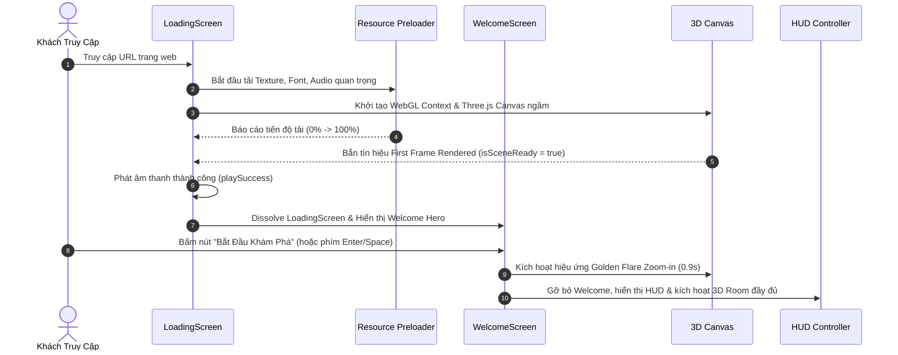

# Đặc Tả Kỹ Thuật: Phân Hệ HUD, Điều Hướng & Đa Ngôn Ngữ

> **Mã Phân Hệ:** `SPEC-06`  
> **Thành Phần Liên Quan:** `src/components/UI/HUD.*`, `src/components/UI/LoadingScreen.jsx`, `src/components/UI/WelcomeScreen.jsx`, `src/i18n/*`  
> **Trạng Thái:** Đã hoàn thiện & Tinh giản  

---

## 1. Mục Tiêu & Phạm Vi (Objective & Scope)

Phân hệ **HUD (Heads-Up Display) & Điều Hướng** là lớp giao diện điều khiển toàn cục (Global UI Overlay), kết nối trực tiếp trải nghiệm người dùng với không gian 3D.

### Phạm vi chức năng:
- **Floating HUD Capsule:** Cung cấp thanh công cụ nổi tinh gọn ở góc trên màn hình, hỗ trợ đổi thời tiết, chuyển đổi ngôn ngữ và bật/tắt âm thanh.
- **Hệ Thống Song Ngữ Toàn Diện (VI / EN):** Tích hợp thư viện `i18next` dịch thuật 100% nội dung (Portfolio, Game, Tooltips, Menus).
- **Quy Trình Preloading & Cinematic Entry:** Tối ưu hóa thời gian tải tài nguyên ban đầu và đưa người xem vào phòng 3D với hiệu ứng mượt mà.
- **Auto-Fading User Hints:** Hướng dẫn thao tác kéo/cuộn/click tự động ẩn đi để giữ không gian phòng 3D luôn thoáng đãng.

---

## 2. Đặc Tả Giao Diện HUD Tinh Giản (Minimalist HUD)

```
+--------------------------------------------------------------------------+
|  [⚡ Nghia's Room • ☀️ Sáng]               [ ☀️ Sáng v | 🇻🇳 VI | 🔊 ]   |
|                                                                          |
|                                                                          |
|                        KHÔNG GIAN PHÒNG 3D THOÁNG ĐÃNG                    |
|                                                                          |
|                                                                          |
|                                                                          |
|  [ (Auto-fade sau 4.5s) ]                                                |
|  [ ↔ Kéo để xoay góc    ]                                                |
|  [ 🔍 Cuộn để phóng to  ]              [ 💬 Bấm vào PC để xem dự án ]   |
|  [ 👆 Bấm để tương tác  ]                      (Hover Tooltip)           |
+--------------------------------------------------------------------------+
```

### Các thành phần chính của HUD:
1. **Brand Badge (Góc trên bên trái):**
   - Tên thương hiệu cá nhân *"Nghia's Room"*.
   - Chỉ báo thời tiết hiện tại kèm biểu tượng emoji (☀️ Morning / 🌇 Sunset / 🌧️ Rainy / 🌙 Night).
2. **Control Capsule (Góc trên bên phải):**
   - **Preset Selector:** Nút bấm bật danh sách chọn 4 kịch bản ánh sáng.
   - **Language Toggle:** Nút chuyển đổi nhanh `VI` / `EN` với cờ quốc gia tương ứng.
   - **Audio Toggle:** Nút loa bật/tắt toàn bộ âm thanh trang web.
3. **Hover Tooltip (Chân màn hình, canh giữa):**
   - Chỉ xuất hiện khi con trỏ chuột rê qua một vật thể 3D có thể tương tác.
   - Chấm tròn xanh phát sáng neon nhấp nháy kèm văn bản hướng dẫn rõ ràng.
4. **Desktop Hints (Góc dưới bên trái):**
   - Hướng dẫn thao tác chuột. **Tự động mờ dần và ẩn hoàn toàn sau 4.5 giây** hoặc ngay khi người dùng thao tác xoay phòng lần đầu tiên.

---

## 3. Hệ Thống Đa Ngôn Ngữ Quốc Tế (i18n Architecture)

Dự án sử dụng `i18next` và `react-i18next` với cấu trúc resource chuẩn hóa:

```javascript
// Cấu hình ngôn ngữ trong src/i18n/index.js
i18n
  .use(initReactI18next)
  .init({
    resources: {
      vi: { translation: viTranslations },
      en: { translation: enTranslations }
    },
    lng: localStorage.getItem('portfolio_lang') || 'vi',
    fallbackLng: 'en',
    interpolation: { escapeValue: false }
  })
```

### Nguyên tắc xử lý dữ liệu song ngữ:
- Đối với văn bản tĩnh của giao diện (UI labels, buttons, hints, tooltips): Sử dụng hook `useTranslation()` với khóa tra cứu (vd: `t('hud.instructions.drag')`).
- Đối với dữ liệu động từ CMS / Database (Dự án, tiểu sử): Sử dụng hàm helper `lf(vi, en)` để ưu tiên hiển thị ngôn ngữ tương ứng theo ngữ cảnh `i18n.language`.

---

## 4. Vòng Đời Tải Trang & Khởi Động (Loading & Entry Lifecycle)



---

## 5. Tiêu Chí Nghiệm Thu (Acceptance Criteria)

- [x] **Ghi nhớ tùy chọn:** Lựa chọn ngôn ngữ (`vi`/`en`) và trạng thái âm thanh (`muted`/`unmuted`) được lưu trữ bền vững trong `localStorage`.
- [x] **Không giật layout:** Việc chuyển đổi qua lại giữa tiếng Việt và tiếng Anh không làm vỡ bố cục các nút bấm hoặc thẻ modal.
- [x] **Thời gian vào phòng tối ưu:** Tổng thời gian từ khi trang nạp xong đến khi người dùng thao tác được trong phòng 3D không vượt quá 2.5 giây trên đường truyền tiêu chuẩn.

